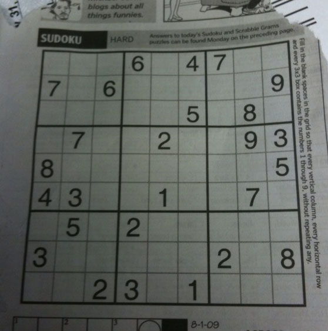
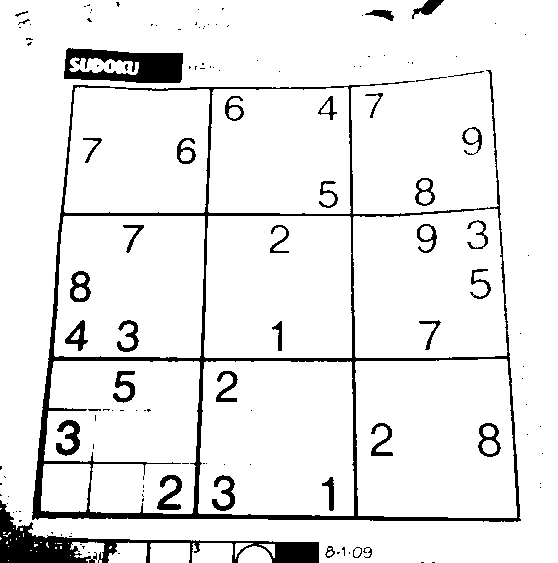
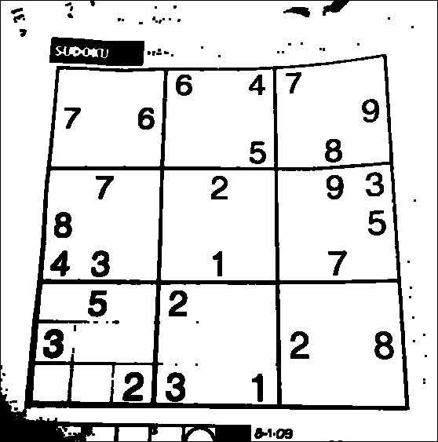
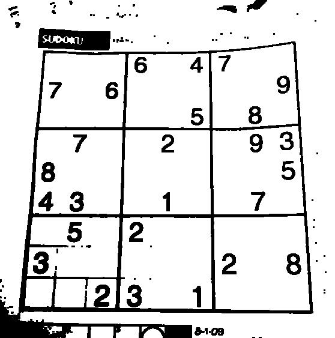

## 1. Теоретическая часть
**Эрозия** (морфологическое размывание) — это одна из базовых операций математической морфологии, применяемая преимущественно к бинарным изображениям. Её основная цель — удаление мелких деталей, разделение слипшихся объектов и сужение границ объектов переднего плана.

Принцип работы заключается в скольжении структурного элемента (ядра, примитива) по изображению. Для каждого пикселя применяется следующее правило:
- Если **все** пиксели под структурным элементом имеют значение переднего плана (например, 255 или 1), центральный пиксель выходного изображения также получает значение переднего плана.
- Если **хотя бы один** пиксель под структурным элементом имеет значение фона (0), центральный пиксель устанавливается в 0.

В данной работе используется структурный элемент размером $3 \times 3$, состоящий из единиц:

$$
K = \begin{bmatrix}
1 & 1 & 1 \\
1 & 1 & 1 \\
1 & 1 & 1
\end{bmatrix}
$$

## 2. Описание разработанной системы
Система реализована на языке Python и включает два варианта алгоритма эрозии:
1. **Нативная реализация на Python**: Алгоритм написан с использованием базовых конструкций языка (вложенные циклы и списки). Изображение преобразуется в двумерный список, после чего для каждого внутреннего пикселя проверяется условие равенства 255 всех 9 элементов окна $3 \times 3$. Граничные пиксели игнорируются (остаются равными 0), что эквивалентно padding'у нулями.
2. **Библиотечная реализация (OpenCV)**: Используется оптимизированная функция `cv2.erode()` с ядром `np.ones((3, 3), np.uint8)`, написанная на C++ под капотом библиотеки.

**Архитектура решения**:
- Загрузка изображения в оттенках серого.
- Бинаризация изображения (с использованием встроенной функции `cv2.threshold`, так как по заданию ручная реализация бинаризации не требуется).
- Последовательный запуск нативного и библиотечного алгоритмов с замером времени выполнения через модуль `time`.
- Визуальное сохранение результатов для сравнения.

## 3. Результаты работы и тестирования системы
Для тестирования использовалось стандартное тестовое изображение (например, `test.png` или любое бинарное изображение с четкими границами). 

### Графики и закономерности
При запуске скрипта на изображении размером ~500x500 пикселей наблюдаются следующие закономерности:
- **Корректность**: Выходные изображения обоих алгоритмов визуально идентичны.
- **Быстродействие**: 
  - Нативная реализация на Python работает значительно медленнее.
  - Реализация на OpenCV работает в десятки раз быстрее благодаря оптимизированным C++ функциям.

После бинаризации

Нативная реализация на Python

Библиотечная реализация (OpenCV)

## 4. Выводы по работе
1. Был успешно реализован алгоритм морфологической эрозии с структурным элементом $3 \times 3$ двумя способами.
2. Нативная реализация на Python подтвердила корректность теоретических основ морфологических операций, однако продемонстрировала низкую производительность, характерную для поэлементной обработки в интерпретируемых языках.
3. Библиотечная реализация (OpenCV) показала превосходство в быстродействии, что делает её единственно приемлемым вариантом для обработки изображений в реальном времени или работы с большими разрешениями.
4. Цель лабораторной работы достигнута: получены практические навыки реализации и сравнительного анализа алгоритмов обработки изображений.
