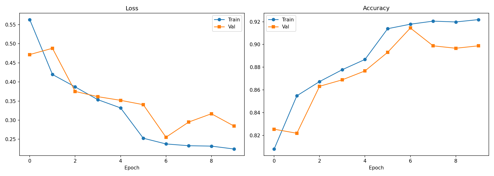
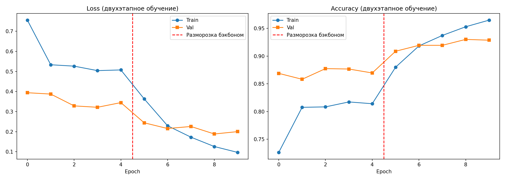
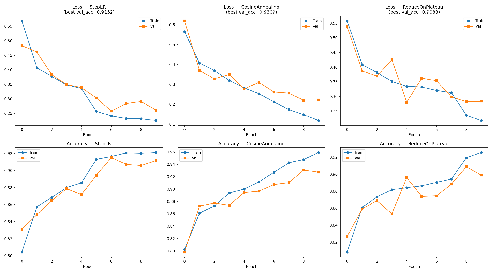
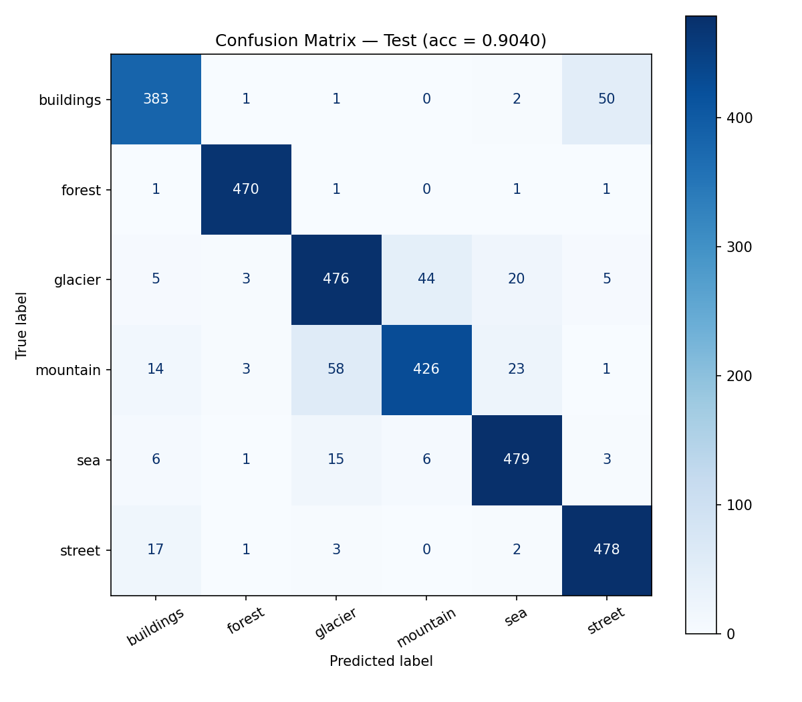

# Отчет по лабораторной работе №3

### 1. Теоретическая база
**Сверточные нейронные сети (CNN)** — это класс глубоких нейронных сетей, который наиболее эффективен для анализа и обработки визуальных данных. Основными строительными блоками CNN являются сверточные слои (для извлечения локальных признаков), пулинг-слои (для уменьшения размерности) и полносвязные слои (для классификации).

В данной работе применяется подход **Transfer Learning**. Он заключается в использовании модели, предварительно обученной на огромном датасете (ImageNet), в качестве "бэкбона" (feature extractor) с последующей заменой и дообучением классифицирующей "головы" под конкретную задачу. Это позволяет значительно ускорить сходимость и достичь высокого качества даже при ограниченных объемах данных.

В качестве базовой архитектуры выбрана **ResNet18**.

### 2. Описание разработанной системы
* **Датасет**: [Intel Image Classification](https://www.kaggle.com/datasets/puneet6060/intel-image-classification). Содержит изображения природных и городских пейзажей, разделенные на 6 классов: `buildings` (здания), `forest` (лес), `glacier` (ледник), `mountain` (горы), `sea` (море), `street` (улица). 
  * Train + Val: ~14 034 изображений.
  * Test: 3 000 изображений.
* **Предобработка и аугментации**:
  * Аугментации для train-выборки: случайные горизонтальные отражения (`RandomHorizontalFlip`), повороты на ±15° (`RandomRotation`), изменение яркости/контраста/насыщенности (`ColorJitter`).
  * Нормализация тензоров по среднему и стандартному отклонению датасета ImageNet.
* **Архитектура модели**: `torchvision.models.resnet18` с предобученными весами `IMAGENET1K_V1`. Полносвязный классификатор (`fc`) заменен на последовательность: `Dropout(0.3)` -> `Linear(512, 6)`.
* **Функция потерь (Loss)**: `CrossEntropyLoss`.
* **Оптимизатор**: `Adam` (lr=1e-3, weight_decay=1e-4 для L2-регуляризации).
* **Метрики качества**: Accuracy, Precision, Recall, F1-score, Confusion Matrix (матрица ошибок).
* **Системные требования**: Python 3.10+, PyTorch 2.x.

### 3. Результаты работы и тестирования системы
В ходе работы было проведено несколько экспериментов для поиска оптимальной стратегии обучения:
1. **Exp1 (Base)**: Базовое обучение всех слоев с `StepLR`. *Best Val Acc: 0.9145*.
2. **Exp2 (Two-stage)**: Двухэтапное обучение (сначала обучается только "голова" при замороженном бэкбоне, затем сеть "размораживается" полностью). *Best Val Acc: 0.9301*.
3. **Exp3 (Schedulers)**: Сравнение различных планировщиков скорости обучения (StepLR, CosineAnnealing, ReduceOnPlateau). Наилучший результат показал **CosineAnnealingLR**. *Best Val Acc: 0.9309*.

**Итоговая модель**: Exp3 с CosineAnnealingLR.

#### Графики обучения

#### Матрица ошибок и классификационный отчет

**Результаты на тестовой выборке (Test Accuracy: 91.73%)**:
* **Отлично распознаются**: `forest` (F1=0.98), `sea` (F1=0.94), `buildings` и `street` (F1=0.92).
* **Возникают трудности**: `glacier` (F1=0.86) и `mountain` (F1=0.88).

**Закономерности**: Модель чаще всего путает ледники (`glacier`) и горы (`mountain`). Это вполне ожидаемо и объяснимо, так как эти классы имеют высокую визуальную и семантическую схожесть (снег, скалистая местность, преобладание белого и серого цветов).

### 4. Выводы по работе
1. В ходе лабораторной работы была успешно разработана система классификации изображений на основе CNN с использованием трансферного обучения.
2. Применение предобученной модели ResNet18 позволило быстро достичь высокого качества (более 93% на валидации и ~91.7% на тесте).
3. Использование аугментаций, слоя `Dropout` и L2-регуляризации (`weight_decay`) успешно предотвратило переобучение модели.
4. Эксперименты показали, что двухэтапное обучение (Two-stage) и плавное изменение learning rate с помощью `CosineAnnealing` дают стабильный прирост качества по сравнению с классическим обучением "в лоб" и `StepLR`.
5. Анализ матрицы ошибок выявил, что основные неточности связаны с объективной сложностью разделения визуально близких классов (горы и ледники), что является нормальным поведением для CNN.

### 5. Использованные источники
1. Документация PyTorch и Torchvision: https://pytorch.org/docs/stable/
2. Датасет Intel Image Classification на Kaggle: https://www.kaggle.com/datasets/puneet6060/intel-image-classification
3. He, K., Zhang, X., Ren, S., & Sun, J. (2016). *Deep Residual Learning for Image Recognition*. CVPR.
